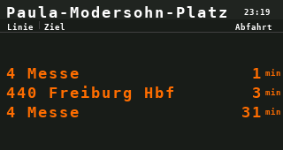
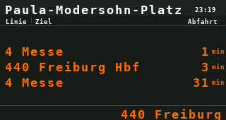
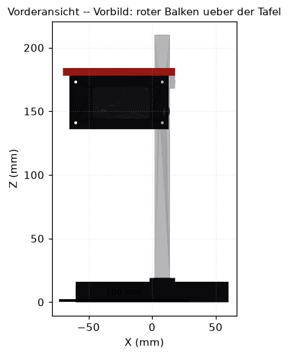

# Tram Departure Display — a Miniature VAG Sign

A departure board for the 1.9" display of the **LilyGO T-Display S3** (ESP32-S3R8).
It shows the next departures from a tram stop, refreshes every 30 seconds, and
includes real-time delays. The look mimics the orange LED departure boards (DFI)
used at VAG stops in Freiburg.



The board is deliberately small and self-contained: no API key, no server, no
cloud account — an ESP32 with WiFi that polls a public endpoint.

## What it does

* **Next departures, tram and bus mixed** by actual departure time (the order
  comes from the server, not from the line type).
* **Real-time delay ticker** along the bottom, exactly like the scrolling
  service message on the real boards. It only appears when a delay exists —
  otherwise the list uses the full height.
* **Blinking tram symbol** when a vehicle is arriving now (0 min), like the real
  signs.
* **Live clock** from NTP, so it keeps ticking even if a fetch fails.
* **Two display styles**, switchable via `DISPLAY_STYLE`: the VAG DFI look
  (orange on dark blue-grey) and a colour look with line badges.



## Data source (verified live)

**NVBW/EFA endpoint Baden-Württemberg** — `https://www.efa-bw.de/nvbw/XML_DM_REQUEST`

* Returns real-time VAG Freiburg departures as JSON, **no API key**.
* Checked on 2026-11-19: Bertoldsbrunnen, Hauptbahnhof, Merzhausen Ortsmitte.
* Field `countdown` = minutes until departure (verified against the clock).
* Delay in minutes in `servingLine.delay`.
* TLS: certificate from **GlobalSign Root CA – R6** (valid until 2034), embedded
  in the code as `ROOT_CA`.

Second source (fallback): **transitous** —
`https://api.transitous.org/api/v1/stoptimes?stopId=<id>&n=6`
(Let's Encrypt certificate, also keyless). Uses different field names
(`stopTimes[]`, `routeShortName`, `headsign`).

### A gotcha worth knowing

The EFA server returns **every number as a string** (`"countdown":"2"`, not `2`).
With ArduinoJson, `e["countdown"] | -1` therefore silently yields the default
`-1`, not the value — which is what caused an early version to display `0 min`
for everything. The fix is a small helper that accepts both forms:

```cpp
static int zahlAus(JsonVariantConst v, int standard) {
  if (v.is<int>()) return v.as<int>();
  const char *t = v.as<const char *>();
  return t ? atoi(t) : standard;
}
```

## Hardware

| Property | Value |
|---|---|
| SoC | ESP32-S3R8, 240 MHz, 16 MB flash, 8 MB OPI-PSRAM |
| Display | 1.9" ST7789, 170×320, IPS, **8-bit parallel bus** |
| Quirk | GPIO15 powers the peripheral rail — **must be HIGH**, otherwise the panel stays dark |
| Backlight | GPIO38 |
| Buttons | GPIO0 (BOOT), GPIO14 |

Pin mapping and display init come from the LilyGO repo
(`Xinyuan-LilyGO/T-Display-S3`).

## Holder (3D print)

The `hardware/` folder contains a 3D-printable miniature of the VAG DFI sign the
board imitates: a black bezel for the display, the red crossbar above it, a
square white pole and a base with a routed cable channel. Six parts, ~57 g of
PLA, no supports. The window shows only the screen (45 × 25 mm) and the board is
centred by a glass recess inside the bezel.



Build guide, part list, dimensions and the fit-check scripts:
**[hardware/README.md](hardware/README.md)**.

## Structure

```
tram-display/
├── platformio.ini            PlatformIO configuration
├── boards/
│   └── lilygo-t-display-s3.json
├── include/
│   ├── config.paula-messe.h  Template -> copy to config.h (active config)
│   ├── config.littenweiler.h Example: line 1 towards Littenweiler
│   └── (config.h)            not in the repo -- WiFi credentials, create from template
├── src/
│   └── main.cpp              Firmware
├── hardware/                3D-printable holder (see hardware/README.md)
│   ├── build_bracket.py      Part definitions + fit check
│   ├── board_fit.py          Places the official board model in the bezel
│   ├── get_board_model.py    Fetches the LilyGO model (not redistributed)
│   ├── stl/                  STL + 3MF exports
│   └── preview/              Rendered previews and the dimensioned drawing
└── docs/
    ├── dfi_vorschau.png      Preview of the DFI look
    ├── littenweiler_vorschau.png  Preview of the Littenweiler filter
    ├── pmp_messe_vorschau.png     Preview: Paula-Modersohn-Platz -> Messe
    ├── pmp_bus_vorschau.png       Preview: tram and bus mixed
    ├── pmp_meldung_vorschau.png   Preview with the delay ticker
    └── pmp_einfahrt_blink.png     Preview with the blinking tram symbol
```

## Configuration

`include/config.h` is the **active** file the firmware includes. It is listed in
`.gitignore` (so WiFi credentials never end up in the repo) and is therefore
**not** part of the repository. After cloning, copy the template once:

```bash
cp include/config.paula-messe.h include/config.h
```

Then add your WiFi credentials — the stop and filters are already set
(**Paula-Modersohn-Platz, line 4 towards Messe and bus 440 towards Hbf**).

Further ready-made examples sit next to it. To switch stops, simply copy one
over `config.h`:

| File | Stop | Filter |
|---|---|---|
| `config.littenweiler.h` | Bertoldsbrunnen | Line 1 → Littenweiler |
| `config.paula-messe.h` | Paula-Modersohn-Platz | Line 4 → Messe |

```bash
cp include/config.littenweiler.h include/config.h
```

Both verified live on 2026-11-19:

* **Littenweiler:** 4 matches out of 30 requested departures, line 1 every
  7–8 minutes, platform 1.
* **Paula-Modersohn-Platz → Messe:** 11 matches out of 30, line 4 every
  ~10 minutes, platform 1. Note: line 4 runs in three directions here
  (Vauban, Messe, H.-von-Stephan-Str.) — without a direction filter they mix.

### Two filters, mixed by time

`SHOW_TRAM_ONLY = false` also shows buses. Two filters decide which lines
appear: `FILTER_LINE`/`FILTER_DIRECTION` (tram) and
`FILTER_LINE2`/`FILTER_DIRECTION2` (bus). Tram and bus are **mixed by departure
time** — the order comes from the server. An empty line (`""`) disables that
filter.

## Two display styles

Switchable via `DISPLAY_STYLE` in `config.h`.

**`DISPLAY_STYLE 1` — DFI look** (default, like the VAG stop displays):

* dark blue-grey background, orange LED text
* white header with stop name and server time
* column headers "Linie | Ziel" and "Abfahrt"
* minutes right-aligned with a small "min" unit
* long destinations wrap onto two lines — **at word boundaries**, not mid-word
  (otherwise "Freiburg Hauptbahnhof" becomes "Freiburg Hauptbahn" + "hof")
* **abbreviations** for long destinations: `Hauptbahnhof` → `Hbf`,
  `Bahnhof` → `Bf`. Whole words only, so "Bahnhofstrasse" is left untouched.
  The table (`KUERZUNGEN`) is easy to extend.
* **blinking tram symbol** as soon as a vehicle arrives (0 min), like the real
  signs. Rate adjustable via `BLINK_MS`.
* **delay ticker at the bottom** (like the scrolling service message on the real
  DFIs): appears only when there really is a delay. The departure lines then
  move up. Speed via `LAUF_MS` (smaller = faster).
* **larger font with few rows:** with only one or two departures the font grows
  (as on the real signs, which show only the next two). `MAX_DEPARTURES 3` in the
  active config. Rows sit close together and are **vertically centred**, so no
  empty strip is left at the bottom.

The colours were sampled from a photo of the VAG display at Paula-Modersohn-Platz:
background `#181C23`, header `#21242C`, orange `#FF6E00`.

**`DISPLAY_STYLE 0` — colour look:** coloured line badges, minutes green
(< 5 min) / orange (< 10 min) / red, plus platform and clock time in the row.

## Getting started

1. **Install PlatformIO** (VS Code extension or `pip install platformio`).
2. **Configuration:** copy the template and enter your WiFi credentials:
   ```bash
   cp include/config.paula-messe.h include/config.h
   ```
   `config.h` is not in the repo (WiFi credentials). The template already sets
   stop and filters (Paula-Modersohn-Platz → Messe + bus 440 → Hbf); for another
   stop copy one of the examples from the "Configuration" section above.
3. **Flash:**
   ```bash
   pio run -t upload
   pio device monitor
   ```
   On the first upload you may need to hold the BOOT button (GPIO0).

## Finding a stop ID

The endpoint expects an EFA ID of the form `de:08311:30100` (Freiburg =
`08311`). Here is how to find one:

```bash
curl -s --get \
  --data-urlencode "outputFormat=JSON" \
  --data-urlencode "type_sf=any" \
  --data-urlencode "name_sf=Hauptbahnhof Freiburg" \
  --data-urlencode "coordOutputFormat=WGS84[dd.ddddd]" \
  "https://www.efa-bw.de/nvbw/XML_STOPFINDER_REQUEST" | python3 -m json.tool
```

The ID is in `stopFinder.points.point.ref.gid` (e.g. `de:08311:30100`). With
several matches, `points` holds a list.

## Limitations and known issues

* **Pinned library version:** `platformio.ini` pins the GFX library to **1.6.0**.
  This is deliberate and must not be reverted to `^1.4.9` — newer versions
  require `esp32-hal-periman.h` (only present in Arduino core 3.x), and 1.6.1 has
  a broken version guard (`esp_rgb_panel_t` missing). Details are a comment in
  `platformio.ini`.
* **Build verified:** `pio run` completes cleanly with PlatformIO Core 6.2.0 and
  `espressif32@6.5.0` (flash 13.7%, RAM 14.1%).
* **Umlauts:** the built-in GFX font has no umlauts. Destinations such as
  "Zähringen" may render incorrectly. Workaround: embed a Unicode font (e.g.
  `u8g2_font_...` via `U8g2_for_Adafruit_GFX`) or replace the characters.
* **Platform = direction:** at Paula-Modersohn-Platz, line 4 departs from
  platform 1 towards Messe and from platform 2 towards Vauban (verified over 120
  departures). The **direction** filter is therefore more robust than filtering
  by platform — platform 1 occasionally also serves pull-in/pull-out runs
  towards "H.-von-Stephan-Str.".
* **Region-specific:** the EFA endpoint covers Baden-Württemberg. Other regions
  need a different EFA/HAFAS endpoint and, if the JSON layout differs, a small
  parser change.

## License

MIT — see [LICENSE](LICENSE).
