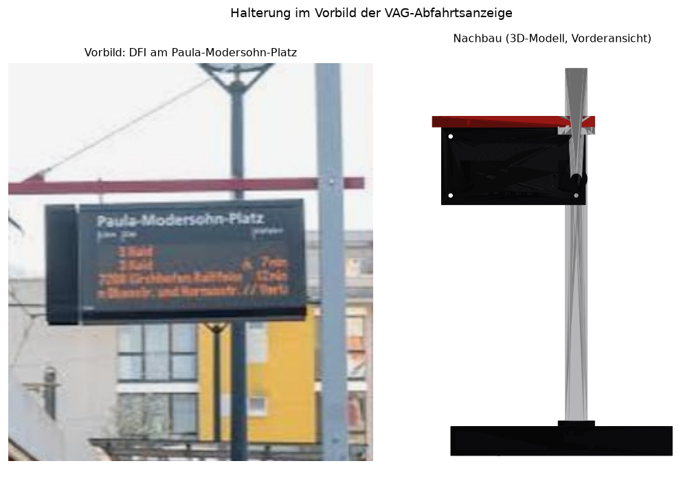
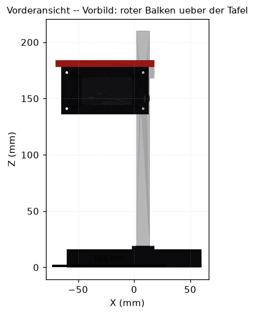
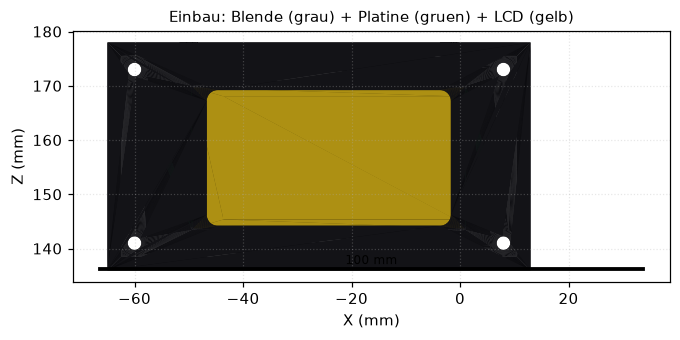
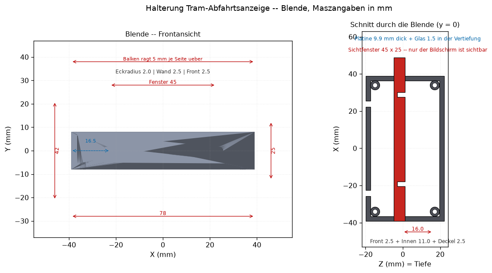

# Holder — Build Guide

A 3D-printed miniature of the VAG departure display (DFI) for the LilyGO
T-Display S3. The board sits in a black bezel, the red crossbar runs above it,
and the whole panel hangs on a white pole via a clamp.



*Left: the original at Paula-Modersohn-Platz. Right: the 3D model.*



*Front view: black bezel, red crossbar, white pole on a black base.*



*Fit check: the board (green) in the bezel — only the LCD (yellow) shows
through the window.*



*Dimensioned drawing of the bezel (front view and section).*

## Colours

| Part | Colour |
|---|---|
| Pole + clamp | **white** |
| Crossbar | **red** |
| Bezel + back cover | **black** |
| Base | **black** |

## Scale

The bezel is **78 × 42 × 16 mm**. The real DFI panel is about one metre wide, so
the replica sits at roughly **1:13**. The frame is necessarily a little wider
than the original because the PCB (61.98 mm) is wider than the display module
(49.87 mm). The **window shows only the screen**: it is exactly **45 × 25 mm**
(the active area) and sits millimetre-precise over the LCD. The red crossbar
overhangs the bezel by **5 mm on each side**, matching the original.

## Dimensions

All values in millimetres. The board dimensions are **measured, not estimated** —
they come from LilyGO's official drawing (`dimensions/t-display-s3-full.stl`)
and the product page (62 × 26 × 10 mm, USB-C on the short edge).

| Part | Outer size | Notes |
|---|---|---|
| Bezel | 78.0 × 42.0 × 16.0 | window 45 × 25, corner R2.0, glass recess inside |
| Back cover | 78.0 × 42.0 × 3.7 | lip 1.2 mm, 4 pressure pads (4.7 mm inward), vents |
| Crossbar | 88.0 × 22.0 × 6.0 | overhangs the bezel 5 mm per side, arm to the clamp |
| Pole clamp | 20.0 × 17.0 × 10.0 | slit through both walls, clamp screw, arm screws on top |
| Pole | 12.0 × 9.0 (square), hollow | cable runs inside |
| Base | 120.0 × 90.0 × 16.0 | hollow, routed cable channel |

**Board mounting.** The bezel has a **glass recess** inside
(50.5 × 26.6 × 1.6 mm): the LCD module (49.87 × 25.95 × 1.53) sinks into it, which
centres the board sideways and puts the window over the screen without a gap.
Four **pressure pads** in the back cover push the board forward into the recess —
no screws in the visible area.

**Interior:** 73.0 × 37.0 × 11.0 mm. The board (61.98 × 26.09 × 9.88) rests
against the back cover; the display protrudes into the recess at the front. The
four screw bosses (R2.5) sit outside the board and do not touch it (4.2 mm to
the board corner).

## How the parts are held together

Mostly **screwed** — one joint is a plain push fit. All screws are M3, and every
hole is sized for a self-tapping M3 (1.25 mm pilot radius) except the clamp
screw, which passes through a 1.6 mm hole.

| Joint | How | Screws |
|---|---|---|
| Bezel ↔ back cover | screwed through the four bosses | 4 × M3 × 12 |
| Crossbar ↔ bezel | screwed from above into the bezel's top wall | 2 × M3 |
| Crossbar arm ↔ clamp | screwed from above, arm rests on the clamp top | 2 × M3 |
| Clamp ↔ pole | clamp screw squeezes the slit | 1 × M3 |
| Pole ↔ base | **push fit** into the socket — no screw | — |

So you only need a screwdriver for the display cover and the head assembly; the
pole simply plugs into the base. Nine M3 screws in total.

## Part list

| No. | File | Qty | Colour |
|---|---|---|---|
| 1 | `stl/01_blende.stl` | 1 | black |
| 2 | `stl/02_rueckdeckel.stl` | 1 | black |
| 3 | `stl/03_querbalken.stl` | 1 | red |
| 4 | `stl/04_schelle.stl` | 1 | white |
| 5 | `stl/05_mast.stl` | 1 | white |
| 6 | `stl/06_sockel.stl` | 1 | black |

Together they need about **57 g of PLA** at 20 % infill.

`stl/alle_teile.3mf` holds all parts side by side on one plate. Individual 3MF
files sit next to it, in case a print service prefers those.

## Printing

* **Material:** PLA is fine. No supports needed — every part is built flat and
  the window opening is a straight through-hole.
* **Layer height:** 0.2 mm. **Walls:** 3 perimeters. **Infill:** 20 %.
* **Bezel:** print as oriented in the file (back on the bed) — then the window
  needs no bridging.
* **Pole:** print upright (square profile, the cable channel comes out clean).
* **Clamp:** print flat, the bore comes out clean.
* Colours come from a filament swap per part — all parts are separate, so a
  multi-colour printer is not required.

## Assembly

1. Drop the board into the bezel with the display facing forward. The LCD module
   settles into the glass recess and centres the board by itself.
2. Fit the back cover (the lip snaps in) and screw it with **4 × M3 × 12**
   through the bosses. The pilot holes are sized for self-tapping M3
   (1.25 mm radius). The four pads push the board forward.
3. Plug the USB-C extension into the board and feed the cable through the
   grommet on the back cover.
4. Slide the clamp onto the pole and push the pole into the base socket (a
   plain push fit — no screw here). Set the clamp at the height of the crossbar.
5. Screw the crossbar to the top of the bezel with **2 × M3** from above, then
   lower the panel onto the clamp and screw the arm down with **2 × M3** from
   above. The arm rests flat on the clamp top.
6. Tighten the clamp with **1 × M3** through the slit — this is what pinches the
   clamp onto the pole.
7. Run the cable down the pole and plug it into the panel-mount socket in the
   base wall.

**No sand.** The base is hollow and stays empty — the 120 × 90 mm footprint is
big enough. The cable path is routed as a channel inside the base and stays
clean. If you want extra protection against cable pull, a hook-and-loop strap
under the base is enough.

## Cable

From the board (panel) through the pole to the socket in the base the model
needs about **28 cm**. You want a **USB-C extension, plug → socket**:

* **0.2 m is not enough.** **0.5 m** is the safe choice (0.3 m is tight).
* Cleaner: a **panel-mount extension** with a flange/thread — the socket is then
  screwed firmly into the base wall.

The base wall has a **13.4 × 10.2 mm hole** (width × height) — the mounting
dimension of the **panel-mount socket**. Because the hole spans almost the full
base height, the wall is reinforced with a rib on the inside.

## Where the numbers come from

```
t-display-s3-full.stl (official, LilyGO)
  body 1 (PCB + display):  26.09 × 61.98 ×  7.86 mm
  body 2 (display glass):  25.95 × 49.87 ×  1.53 mm
product page lilygo.cc: 62 × 26 × 10 mm, USB-C on the short edge
```

The LilyGO model is MIT-licensed third-party data, so it is **not redistributed
here**. Fetch it once into `ref/`:

```sh
python3 hardware/get_board_model.py
```

`build_bracket.py` reads its values from the `PARAMETER` block. To change
something, edit there and re-run the scripts:

```sh
PYTHONPATH=<your site-packages> python3 build_bracket.py   # parts + fit check
PYTHONPATH=<your site-packages> python3 board_fit.py        # board in the bezel
PYTHONPATH=<your site-packages> python3 export_3mf.py       # 3MF for a print service
PYTHONPATH=<your site-packages> python3 drawing.py          # dimensioned drawing
PYTHONPATH=<your site-packages> python3 compare.py          # comparison with the original
```

(Needs `trimesh` with `manifold3d`, plus `numpy`, `matplotlib` and `Pillow`.)

`build_bracket.py` recomputes the fit check on every run: clearance, distance
from the screw bosses to the board, and pilot hole to the outer wall.
`board_fit.py` loads the **official** board from the LilyGO file, places it in
the bezel and verifies by cross-section and volume intersection that the active
area lies fully inside the window and that the glass does not pierce the front
wall. That way a design error shows up immediately instead of on the printed
part.
